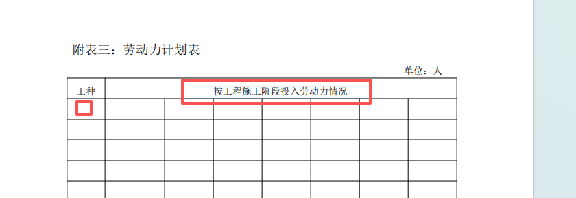

# 槐林镇2026年度和美乡村省级中心村建设项目施工组织设计

## 工程概况

本工程位于槐林镇沿湖片区，主要建设内容为道路硬化、排水管网、文化广场及绿化提升四部分，计划工期一百二十日历天。

### 项目简介

#### 建设内容与规模

道路硬化面积约一万二千平方米，排水主管网总长约三千八百米，新建文化广场一处并配套绿化、亮化设施。

## 第二章 质量保证

本章依据现行国家施工质量验收规范编制，质量目标为一次验收合格率百分之百。

### 质量管理体系

#### 三检制

班组自检、项目部互检、公司专检三级检验合格后方可报监理验收，检验记录当日归档。

| 工序节点 | 施工方法及控制参数 | 质量控制要点 |
| --- | --- | --- |
| 塘底清淤 | 长臂挖机分段清淤，深度偏差不大于五十毫米 | 隐蔽验收合格后方可回填 |
| 路基整平 | 推土机粗平加平地机精平，压实度不小于百分之九十三 | 每二百米检测一点 |

## 施工部署与进度计划

施工组织按先地下后地上、先深后浅的顺序推进，各专业班组穿插流水作业，交叉部位由技术负责人统一协调。

### 现场布置与形象进度

施工现场沿规划道路布置临时围挡与洒水降尘设施，主出入口设冲洗平台，出场车辆一律冲洗后放行。




{wide}

```gantt
2026-12-01..2026-12-10 | 塘底清淤
2026-12-05..2026-12-20 | 管网敷设
2026-12-15..2026-12-25 | 路基整平
```
